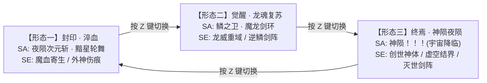

<div align="center">

# 拔刀剑：终焉藏刀阁
### *SlashBlade: Finale Blade Sanctum*

<p align="center">
  <b>撕裂虚空，执掌法则；八荒破灭，终焉归墟。</b><br>
  <i>融合高维视效、深度机制与多元战斗链路的 SlashBlade 26.1.2 Fabric 扩展模组</i>
</p>

[](https://www.minecraft.net/)
[](https://fabricmc.net/)
[](https://adoptium.net/)
[](#)
[](#)
[](./LICENSE)
[](#)

<br>

[📖 模组概览](#-模组概览) • [✨ 核心特性](#-核心特性) • [📋 环境依赖](#-环境与依赖) • [⚔️ 命名刀图鉴](#️-命名刀图鉴) • [🔮 专属 SA](#-sa-slash-art-专属战技) • [🌀 特效 SE](#-se-special-effect-特效体系) • [🎮 操作快捷键](#-控制与快捷键说明) • [⚙️ 配置体系](#️-配置文件体系-forge-config-api-port) • [🎨 OBJ 制作](#-拔刀剑-obj-模型制作指南) • [🛠️ 源码构建](#️-构建与编译指南) • [💖 赞助支持](#-赞助与支持)

</div>

---

## 📖 模组概览

**拔刀剑：终焉藏刀阁** (*SlashBlade: Finale Blade Sanctum*) 是一款基于 *SlashBlade: Refabricated* 的 **Minecraft 26.1.2 Fabric** 拔刀剑扩展模组（完整移植自 1.21.1 NeoForge 版本）。

本模组围绕 **“终焉、裂界、坍缩、审判、血狱、宇宙法则、混沌魔龙、萝莉法则”** 八大核心主题构建，提供了 **5 把机制独特的顶级命名刀**、完整严谨的 **SA / SE 战斗链路**、接入 **Forge Config API Port (`ModConfigSpec`)** 的低风险参数调节体系，以及针对 Minecraft 26.1.2 全新渲染架构重制的 **动态视效与自定义 Tooltip 系统**。

> [!NOTE]
> 当前 README 对应版本 **`2.9.4-hotfix2-26.1.2-fabric`**。本版本已全面适配 Minecraft `26.1.2`（Java 25）与 `SlashBlade: Refabricated`，完成了 `GuiGraphicsExtractor` 自定义 Tooltip 重绘、`SubmitNodeCollector` 闪电与实体渲染、`HudElementRegistry` 血狱屏幕覆盖层、`RenderOverrideEvent` 魔龙光环接管、单人集成端与独立服务端统一的 Theseus Guard 守护，并修正了 `ModConfig` 静态初始化顺序问题。

---

## ✨ 核心特性

```
┌────────────────────────────────────────────────────────────────────────┐
│                        🌌 终 焉 藏 刀 阁  特 性 矩 阵                   │
├───────────────────┬───────────────────┬────────────────────────────────┤
│ 🗡️ 5 大顶级命名刀  │ 🌀 7 大专属 SA     │ ⚡ 24 项注册 SE 体系           │
│ 湮灭/血狱/星空/魔龙/萝莉│ 空间裂界/绝对坍缩/神陨│ 终焉/血狱/宇宙/魔龙/萝莉法则    │
├───────────────────┼───────────────────┼────────────────────────────────┤
│ 🎨 旗舰级 Tooltip  │ ⚙️ ForgeConfig 双配置│ 🛡️ 萝莉高维守护体系            │
│ 黑洞/六芒星/全息芯片/色差│ 权威服务端 + 客户端视效│ 主人唯一绑定 / 兜底契约重建     │
└───────────────────┴───────────────────┴────────────────────────────────┘
```

- 🗡️ **5 把机制与定位鲜明的顶级命名刀**：湮灭之刃·终焉、魔刀·血狱、最终兵器·无尽星空、魔龙夜陨、萝莉刀「萝莉(。>︿<   。)」。
- 🌀 **7 大专属 SA（Slash Art）**：`空间破碎`、`炼狱·杀戮`、`绝对湮灭圈`、`夜陨次元斩`、`鳞之卫`、`神陨！！！`（神陨·宇宙夜陨降临）、`萝莉审判·Ciallo～(∠・ω< )⌒☆`。
- ⚡ **24 项注册 SE（Special Effect）**：涵盖终焉系 (8)、血狱系 (3)、宇宙法则系 (4)、魔龙系 (8) 与萝莉裁断系 (1)。
- 🎀 **萝莉刀服务端高压防护与契约机制**：主人唯一绑定、原生 SE/SA 主动处决、命中节流音效、多维死锁防护（7 项通用/服务端 Mixin + `LoliBladeTheseusGuard` 集成端/专用服务端全覆盖）与可选高压对抗项。
- ⚙️ **Forge Config API Port TOML 权威配置**：在 `config/` 下生成 `annihilationbladeex-common.toml`（服务端权威控制）与 `annihilationbladeex-client.toml`（客户端 Tooltip 视效开关），所有数值均附带安全边界校验。
- 🎨 **旗舰级专属 Tooltip 重绘系统**：湮灭之刃、无尽星空与魔龙夜陨均拥有基于 Minecraft 26.1.2 `GuiGraphicsExtractor` 与多边形渲染状态重制的专属面板（流光黑洞、六芒星公转、谱线文字、3×3 龙威权能全效果芯片组、交互式鼠标聚光灯追踪与色差故障错位），支持一键关闭回退原版样式。
- 🎮 **人性化按键控制与动作栏反馈**：支持断空闪现模式切换（默认 <kbd>Left Ctrl</kbd>）、魔龙夜陨三形态切换（默认 <kbd>Z</kbd>）、无尽星空 AI 删除开关（默认 <kbd>I</kbd>）与 AI 复原开关（默认 <kbd>C</kbd>），且攻击判定深度遵循 SlashBlade 原生友伤与 PVP 规则。

---

## 📋 环境与依赖

| 需求项目 | 推荐 / 要求版本 | 依赖类型 | 说明 |
| :--- | :--- | :---: | :--- |
| **Minecraft** | `26.1.2` | 运行基石 | 目标游戏基准版本 |
| **Fabric Loader** | `>= 0.20.1` | 加载器 | 推荐 `0.20.1` 或更高版本 |
| **Fabric API** | `0.155.3+26.1.2` 或更高 | **核心前置** | 提供事件、网络载荷、按键绑定、HUD 与模型加载 API |
| **Java (JDK/JRE)** | `25` | 运行时 | 推荐采用 Azul Zulu 25 / OpenJDK 25 / Eclipse Adoptium 25 |
| **SlashBlade: Refabricated** | `>= 26.1.2-1.5.1` | **核心前置** | 如 `26.1.2-1.5.1-Resharped-2.0.5`（内置 Cardinal Components API `8.0.0`） |
| **Forge Config API Port** | `>= 26.1.4` | **必需前置** | 已验证 `26.1.5`，驱动 `ModConfigSpec` TOML 配置生成与加载 |
| **Mod Menu / JEI / EMI** | 最新兼容版 | *可选联动* | 提供配置界面入口与命名刀配方/图鉴检索 |

---

## ⚔️ 命名刀图鉴

<details open>
<summary><b>1. 湮灭之刃 · 终焉 <code>annihilationbladeex:annihilation_blade</code></b></summary>
<br>

> *「撕裂虚空，终焉裁决。万物因果，尽归寂灭。」*

- **数据包定义**：`src/main/resources/data/annihilationbladeex/slashblade/named_blades/annihilation_blade.json`

| 属性维度 | 参数数值 | 属性维度 | 参数数值 |
| :--- | :--- | :--- | :--- |
| **基础攻击力** | `50.0` (高额爆发) | **最大耐久值** | `2000` |
| **绑定 SA** | `spatial_fracture` (空间破碎·万象裂隙) | **挂载 SE 数量** | `8` 项终焉系完整效果 |
| **核心被动能力** | 绝对庇护、虚空飞行、终焉处决、永昼视界 | **专属快捷键** | <kbd>Left Ctrl</kbd> 切换断空 / <kbd>Shift</kbd> 刹车 |

> [!TIP]
> **核心战斗机制**：
> - **永昼视界**：置于背包、主手或副手时，客户端通过光照贴图提取器 Mixin（`LightmapRenderStateExtractorMixin`）与伽马调亮提供夜视级无药水图标照明，杜绝污染玩家常规状态栏。
> - **因果裂界连锁**：命中后触发裂隙牵引与范围内目标终焉处决；连锁次数与中心扩散半径均可在 `annihilationbladeex-common.toml` 的 `[annihilation_blade.world_rift]` 下灵活调节。

</details>

<br>

<details open>
<summary><b>2. 魔刀 · 血狱 <code>annihilationbladeex:blood_prison</code></b></summary>
<br>

> *「以血养刃，危机与狂暴交织的嗜血之刀。」*

- **数据包定义**：`src/main/resources/data/annihilationbladeex/slashblade/named_blades/blood_prison.json`

| 属性维度 | 参数数值 | 属性维度 | 参数数值 |
| :--- | :--- | :--- | :--- |
| **基础攻击力** | `16.0` | **最大耐久值** | `2400`（`unbreakable: true`） |
| **绑定 SA** | `infernal_slaughter` (炼狱·杀戮) | **专属挂载 SE** | `blood_leech` / `spirit_shield` / `phantom_mark` (+ `slashblade:wither_edge`) |
| **战斗机制** | 濒危灵盾、嗜血续航、幻影印记引爆 | **数值平衡** | 核心机制紧凑封装于源码层，兼顾生存与爆发 |

> [!NOTE]
> **血色战斗循环**：围绕低生命风险加成、百分比吸血续航、濒危强效护盾与幻影剑雨爆发展开，释放 SA 时同步激活客户端红色血狱覆盖层（`BloodPrisonOverlay`），专为高压攻坚与长时间近战肉搏打造。

</details>

<br>

<details open>
<summary><b>3. 最终兵器 · 无尽星空 <code>annihilationbladeex:infinity_stellaris</code></b></summary>
<br>

> *「超越常规概念、掌控宇宙法则的终局兵器。」*

- **数据包定义**：`src/main/resources/data/annihilationbladeex/slashblade/named_blades/infinity_stellaris.json`

| 属性维度 | 参数数值 | 属性维度 | 参数数值 |
| :--- | :--- | :--- | :--- |
| **基础攻击力** | `1,000,000.0` (百万恒星级) | **最大耐久值** | `2,147,483,647`（`unbreakable: true`） |
| **绑定 SA** | `vacuum_decay_collapse` (绝对湮灭圈) | **专属挂载 SE** | 熵增蚀解、曲率撕裂、伽马霆暴、宇宙弦切 |
| **核心生存被动** | 无敌、飞行、死亡拦截、`/kill` 级防御、坠落保护、永昼视界 | **专属快捷键** | <kbd>I</kbd> AI 删除开关 / <kbd>C</kbd> AI 复原开关 |

> [!IMPORTANT]
> **终局仪式合成**（`data/annihilationbladeex/recipe/annihilationbladeex.infinity_stellaris.json`）：
> 需要 **`annihilationbladeex:annihilation_core` 湮灭核心 × 4**、**龙蛋 × 1**、**信标 × 2**、**下界之星 × 1**，并献祭一把达到 **`5000` 杀敌**、**`25000` 耀魂**、**`50` 精炼** 的魔刀·血狱（`annihilationbladeex:blood_prison`）方可唤醒。
> 
> **星空专属特性**：
> - 拥有专属流光黑洞与六芒星高阶 Tooltip 重绘视效（可在 `annihilationbladeex-client.toml` 一键切换）。
> - 按 <kbd>I</kbd> 键可开关 **曲率撕裂 (Curvature Rupture)**，开启并手持时冻结周围默认 `32` 格（可配置 `curvature_radius`）内合法目标 AI；按 <kbd>C</kbd> 键可切换停止手持或关闭冻结时是否恢复目标原有 AI。

</details>

<br>

<details open>
<summary><b>4. 魔龙夜陨 <code>annihilationbladeex:nightfall_dragon</code></b></summary>
<br>

> *「融合混沌魔龙之力，随战斗节奏切换姿态的多元拔刀。」*

- **数据包定义**：`src/main/resources/data/annihilationbladeex/slashblade/named_blades/nightfall_dragon.json`

| 属性维度 | 参数数值 | 属性维度 | 参数数值 |
| :--- | :--- | :--- | :--- |
| **基础攻击力** | `22.0` (随形态升阶) | **最大耐久值** | `2400`（`unbreakable: true`） |
| **形态切换键** | <kbd>Z</kbd> 键 (主/副手持有状态循环切换) | **视效支持** | 全息激光扫描、3×3 权能芯片、色差故障、龙环光环层 |

#### 🔄 三大形态切换状态机：



- **【形态一：封印 · 淬血】**：挂载 `demonic_blood_parasite` 与 `outer_god_scar`。命中无上限叠加魔血印记，施加凋零 V、失明并追加目标 5% 最大生命魔法伤害与真实伤害；SA【夜陨次元斩】默认以持刀者为中心扫描 `50` 格内合法目标，每隔 `2` tick 在目标脚下或随机点生成巨型次元斩，总计 `100` 斩（以上参数均可在 `annihilationbladeex-common.toml` 调整）。
- **【形态二：觉醒 · 龙魂复苏】**：继承形态一，追加 `dragon_pressure_domain` 与 `reverse_scale_hunt`。获得速度 III、力量 III、夜视 III 与伤害吸收 III；SA【鳞之卫】召唤默认 `16` 柄直立魔龙幻影剑环绕升空重砸，造成 500% 面板 + 10% 最大生命范围重创并引发视角震屏。
- **【形态三：终焉 · 神陨夜陨】**：继承龙威与魔血，挂载 `dragon_god_body`、`absolute_annihilation_domain`、`myriad_dragon_blade_storm` 与 `world_cleaving_slash`。常驻创世神体兜底与最高 200 点创世龙盾，普通挥刀追加默认 `16` 柄灭世龙刃（配置项可调 `10~300`）与 `72` 格撕裂苍穹剑气；SA【神陨！！！】锁定 `120` 格焦点产生 `72` 格强力黑洞漩涡，轰炸默认 `20` 轮 × `5` 剑星陨剑雨，内核坍缩释放全屏冲击波并以 `24` 道紫霄落雷处决半血目标。

</details>

<br>

<details open>
<summary><b>5. 萝莉刀 「萝莉(。>︿<   。)」 <code>annihilationbladeex:loli_blade</code></b></summary>
<br>

> *「高维法则附庸，自带可爱外表与绝对防御/处决契约的特别拔刀。」*

- **数据包定义**：`src/main/resources/data/annihilationbladeex/slashblade/named_blades/loli_blade.json`

| 属性维度 | 参数数值 | 属性维度 | 参数数值 |
| :--- | :--- | :--- | :--- |
| **基础攻击力** | `4.0` (高维法则常数) | **最大耐久值** | `1000` |
| **绑定 SA** | `loli_area_execution` (萝莉审判·Ciallo～) | **绑定 SE** | `loli_facing_execution` (萝莉斩·Ciallo～) |
| **原生满配附魔** | 耐久 X、抢夺 X、多重射击 X、力量 X、灵魂疾行 X、摔落缓冲 X、保护 X、击退 X、经验修补 X |

> [!WARNING]
> **高维契约与绝对防御体系**：
> 1. **主人契约绑定**：首次进入玩家背包自动绑定 UUID，非主人手持完全失去法能。
> 2. **主动处决与专属音效**：手持挥刀触发默认 48 格扇形 SE 处决，释放 SA 触发默认 128 格广域服务端全清处决；每次造成伤害播放专属 `loli_success` 音效（内置防爆音高频节流）。
> 3. **多维守卫 (`Theseus Guard` & Mixin)**：通过服务端 `LoliBlade*Mixin` 与 `LoliBladeTheseusGuard` 拦截伤害、死亡与硬移除状态，兼容整合单人服务端与独立专用服务端；若 `ultimate_theseus` 开启，实体被异常移除后将在 3 tick 后恢复存活态。
> 4. **高压对抗配置**：可在 `annihilationbladeex-common.toml` 的 `[loli_blade]` 分区自由开关 `force_death`、`clear_inventory`、`kick_player`、`remove_entity` 与 `ultimate_obliterate` / `ultimate_invincible` / `ultimate_theseus`。

</details>

---

## 🔮 SA (Slash Art) 专属战技

| SA 战技名称 | 注册标识 (Registry ID) | 适配武器 | 机制简析与视觉演出 |
| :--- | :--- | :---: | :--- |
| **空间破碎** | `annihilationbladeex:spatial_fracture` | 湮灭之刃 | 以视线落点为锚撕开万象裂隙，扫描广域敌对目标逐一处决并铺设高密度因果裂纹。 |
| **炼狱 · 杀戮** | `annihilationbladeex:infernal_slaughter` | 魔刀·血狱 | 展开猩红血狱领域，领域内全速穿梭追猎敌对单位，附带血色覆盖层与粒子爆发。 |
| **绝对湮灭圈** | `annihilationbladeex:vacuum_decay_collapse` | 无尽星空 | 展开 `128×128` 正方绝对湮灭圈持续 5 秒，入圈合法目标直接热寂处决且压制掉落物与方块破坏。 |
| **夜陨次元斩** | `annihilationbladeex:nightfall_judgement_cut` | 魔龙 (形态一) | 默认扫描 50 格内合法目标，每 2 tick 在敌人脚下或随机补位点引爆次元斩，默认累计 100 连斩（均可配置）。 |
| **鳞之卫** | `annihilationbladeex:scale_guard` | 魔龙 (形态二) | 召唤默认 16 柄直立魔龙幻影剑环绕旋转，外展 5 格后升空重砸，造成 500% 面板 + 10% 最大生命伤害与震屏。 |
| **神陨！！！** | `annihilationbladeex:cosmic_nightfall_descent` | 魔龙 (形态三) | 锁定 120 格焦点展开 72 格黑洞漩涡，轰炸默认 20 轮夜陨星雨，伴随坍缩冲击波与 24 道落雷处决半血目标。 |
| **萝莉审判** | `annihilationbladeex:loli_area_execution` | 萝莉刀 | 伴随 `Ciallo～(∠・ω< )⌒☆`，以持刀者为中心展开默认 128 格无死角服务端全清处决并播放音效。 |

---

## 🌀 SE (Special Effect) 特效体系

模组共内建 **24 项系统化注册 SE**（`ModSpecialEffects`），按法则类别归整如下：

| 分类标牌 | SE 注册标识 | 中文正式名称 | 运行机制与实战表现 |
| :---: | :--- | :--- | :--- |
| <kbd>终焉系</kbd> | `annihilationbladeex:dankong` | 断空 · 瞬狱终闪 | 目标间高速闪现斩杀；支持按住 <kbd>Shift</kbd> 刹车返回，按 <kbd>Left Ctrl</kbd> 切换开关 |
| <kbd>终焉系</kbd> | `annihilationbladeex:world_rift` | 裂界 · 因果伤痕 | 命中后在受击点生成拉扯裂隙，触发范围二次处决并支持连锁扩散 |
| <kbd>终焉系</kbd> | `annihilationbladeex:terminus_echo` | 归墟回响 · 终焉余律 | 沿朝向释放多波交替推进的虚空切割带，连续撕裂前方敌群 |
| <kbd>终焉系</kbd> | `annihilationbladeex:void_dominion` | 虚无权域 · 万象湮灭 | 展开前方广域投影，分批次将区域内敌对目标纳入终焉判定逐个抹除 |
| <kbd>终焉系</kbd> | `annihilationbladeex:causality_collapse` | 因果坍缩 · 连锁抹消 | 寻找最近目标建立因果锚点与连接斩线，触发高密连锁爆破 |
| <kbd>终焉系</kbd> | `annihilationbladeex:starless_judgement` | 星寂裁决 · 断天终判 | 沿视线方向释放宽幅星寂裁决波，按投影判定扫过路径目标执行终判 |
| <kbd>终焉系</kbd> | `annihilationbladeex:phantom_judgement` | 幻影审判 · 九剑星轨 | 环绕幻影剑锁定敌群，随后降下密集剑雨集中审判，地面保留剑体标记 |
| <kbd>终焉系</kbd> | `annihilationbladeex:abyssal_decree` | 归墟天诏 · 星冕敕裁 | 在玩家头顶构筑王权星冕，自上而下逐次降下毁灭敕裁光束 |
| <kbd>血狱系</kbd> | `annihilationbladeex:blood_leech` | 嗜血 · 噬血 | 造成伤害时按比例汲取生命，在高压近身搏杀中提供强力续航 |
| <kbd>血狱系</kbd> | `annihilationbladeex:spirit_shield` | 源流 · 灵盾 | 生命值低于濒危阈值时强行构筑灵盾抵御重创，并赋予抗性提升 |
| <kbd>血狱系</kbd> | `annihilationbladeex:phantom_mark` | 幻影 · 印记 | 连续命中叠加印记，叠满层数后召唤幻影剑雨爆发撕裂目标 |
| <kbd>宇宙系</kbd> | `annihilationbladeex:entropy_dissolution` | 熵增蚀解 | 命中追加默认 10% 最大生命扣除，满 10 层直接触发热寂归零抹除非玩家实体 |
| <kbd>宇宙系</kbd> | `annihilationbladeex:curvature_rupture` | 曲率撕裂 | 按 <kbd>I</kbd> 键切换；手持时将周围默认 32 格内合法目标 AI 彻底锁死（支持 <kbd>C</kbd> 切换复原） |
| <kbd>宇宙系</kbd> | `annihilationbladeex:gamma_thunderburst` | 伽马霆暴 | 伤害触发持刀者周围 128 格内连续 3 tick 随机降下自定义彩色伽马闪电实体 |
| <kbd>宇宙系</kbd> | `annihilationbladeex:cosmic_string_cut` | 宇宙弦切 | 挥刀触发局部 5×5×5 星线，切断 128 格立方内所有合法目标 |
| <kbd>魔龙系</kbd> | `annihilationbladeex:demonic_blood_parasite` | 魔血寄生 · 黯焰印记 | 叠加魔血印记，施加凋零 V、失明与 5% 最大生命真伤，满 20 层爆发落剑 |
| <kbd>魔龙系</kbd> | `annihilationbladeex:outer_god_scar` | 外神伤痕 (虚空撕裂) | 封印形态挥刀生成暗紫虚空裂隙与追猎幻影剑 |
| <kbd>魔龙系</kbd> | `annihilationbladeex:dragon_pressure_domain` | 龙威重域 · 诸神余压 | 觉醒形态常驻赋予速度 III、力量 III、夜视 III 与伤害吸收 III |
| <kbd>魔龙系</kbd> | `annihilationbladeex:reverse_scale_hunt` | 逆鳞剑阵 · 燃魂追猎 | 觉醒形态挥刀扫出金紫逆鳞剑阵，挥刀期间获得抗性提升 III 庇护 |
| <kbd>魔龙系</kbd> | `annihilationbladeex:dragon_god_body` | 终焉神像 · 创世神体 | 背包常驻提供死锁兜底、飞行、免疫负面、伤害反弹与最高 200 点创世龙盾 |
| <kbd>魔龙系</kbd> | `annihilationbladeex:absolute_annihilation_domain` | 终焉结界 · 虚空湮灭 | 每秒扫描默认 64 格内合法目标，剥离护盾与冻结 AI 并处决半血目标 |
| <kbd>魔龙系</kbd> | `annihilationbladeex:myriad_dragon_blade_storm` | 万刃龙魂 · 灭世剑阵 | 普通挥刀追加默认 16 柄（配置范围 10~300）暗金/星空紫灭世龙刃自动追猎目标 |
| <kbd>魔龙系</kbd> | `annihilationbladeex:world_cleaving_slash` | 灭界龙威 · 撕裂苍穹 | 挥刀施放默认 72 格撕裂型虚空剑气并附带同源紫霄闪电 |
| <kbd>萝莉系</kbd> | `annihilationbladeex:loli_facing_execution` | 萝莉斩 · Ciallo～ | 接管原生挥刀 SE 事件，沿视线执行默认 48 格扇形高压服务端处决 |

---

## 🎮 控制与快捷键说明

模组内置了通过 Fabric KeyMapping API 注册的热键与动作栏即时反馈系统：

| 控制按键 | 适用武器 | 操作类型 | 机制说明与 HUD 反馈 |
| :---: | :---: | :---: | :--- |
| <kbd>Shift</kbd> (按住) | 湮灭之刃 | 紧急制动 | 防误触与强制刹车：按住时拒绝开启新的断空序列；闪现途中按住则立即刹车并回溯至起点。 |
| <kbd>Left Ctrl</kbd> | 湮灭之刃 | 状态切换 | **断空闪现开关**：自由切换开启/关闭闪现，动作栏显示提示（`当前闪现：开/关`）。 |
| <kbd>Z</kbd> | 魔龙夜陨 | 循环切换 | **形态切换**：在【封印】➔【觉醒】➔【终焉】三态间循环切换，动作栏实时显示当前形态名称。 |
| <kbd>I</kbd> | 无尽星空 | 状态切换 | **曲率 AI 删除开关**：开启后将周围合法目标 AI 锁死，动作栏提示当前开闭状态。 |
| <kbd>C</kbd> | 无尽星空 | 状态切换 | **曲率 AI 复原开关**：控制停止手持或关闭删除时是否复原生物 AI（默认开启，关闭时会弹出提示）。 |

> [!TIP]
> **目标合法性判定安全准则**：  
> 所有普通攻击、SA 战技与 SE 特效的目标选取判定均深度遵循 SlashBlade 原生 `pvp_enable` 与 `friendly_enable` 规范（`SlashBladeTargeting`），默认情况下绝不误伤玩家自身、同伴驯服宠物与无害友好生物。

---

## ⚙️ 配置文件体系 (Forge Config API Port)

模组在 Fabric 26.1.2 端通过 **Forge Config API Port (`ModConfigSpec`)** 管理配置。在首次启动后，将在 `.minecraft/config/` 路径下生成两份 TOML 配置文件：

```
config/
├── annihilationbladeex-common.toml   # [服务端权威] 涵盖范围、冷却、粒子步长、连锁数、夜临玄龙参数与萝莉刀对抗开关
└── annihilationbladeex-client.toml   # [客户端视效] 涵盖三大命名刀专属 Tooltip/HUD 渲染开关
```

### 1. 服务端核心配置 (`annihilationbladeex-common.toml`)
- 包含 `[annihilation_blade]`、`[blood_prison]`、`[infinity_stellaris]`、`[nightfall_dragon]` 与 `[loli_blade]` 五大分区，覆盖搜索距离、领域半径、判定冷却 Tick、连锁上限、陨剑波数等。
- 所有浮点与整型数值均通过 `defineInRange` 配置硬边界校验，彻底杜绝配置溢出崩服。
- 包含萝莉刀 `force_death` 兜底处决与 `ultimate_obliterate` / `ultimate_invincible` / `ultimate_theseus` 等对抗开关。

### 2. 客户端视效配置 (`annihilationbladeex-client.toml`)
```toml
#客户端专属 Tooltip 特效渲染开关
[client_tooltips]
	#是否启用湮灭之刃自定义 Tooltip 渲染器
	enable_annihilation_blade_renderer = true
	#是否启用无尽星空自定义 Tooltip 渲染器
	enable_infinity_stellaris_renderer = true
	#是否启用夜临玄龙自定义 Tooltip 渲染器
	enable_nightfall_dragon_renderer = true
```
- **一键回退机制**：当关闭自定义 Tooltip 渲染器时，将丝滑回退至原版物品提示，保证对各类高分辨率界面、JEI / EMI 或自定义 HUD 模组的无缝兼容。

---

## 🎨 拔刀剑 OBJ 模型制作指南

本章节整理自 MC 百科《适用于“拔刀剑：重锋”的拔刀剑 obj 模型制作教程》，便于附属开发与自制刀剑资产对接。

### 标准分组命名规范 (Groups)

在导出或制作适用于 SlashBlade 的 OBJ 模型时，必须规范以下材质组名：

| 模型分组 (Group Name) | 呈现形态与生效视角 |
| :--- | :--- |
| `sheath` | 佩戴在玩家腰间或背部的刀鞘模型（第三人称） |
| `blade` | 正常手持时所展现的完整刀身模型（第三人称） |
| `blade_damaged` | 耐久耗尽后的断刀刀身模型（第三人称） |
| `blade_fragment` | 拔刀断裂时飞出并插在地面的断刃碎片 |
| `effect` | 蓄力释放 SA 或长按时的刀身/刀鞘发光特效层 |
| `item_blade` | 物品栏图标、GUI 面板与快捷栏视角的完整刀形态 |
| `item_damaged` | 物品栏中的断刀图标形态 |
| `blade_luminous` / `sheath_luminous` | *[本项目扩展]* 满光能量流动层渲染分组 |

> [!TIP]
> **Blender 建模注意事项**：
> 1. 导入官方基准模型后，**切勿平移、旋转或缩放基准坐标原点**，必须严格以基准为标尺进行对齐。
> 2. 导出 OBJ 时，务必勾选 `Write Groups` (写入组)，且全部面片必须确保为 **三角面 (Triangulate Faces)**。

---

## 🛠️ 构建与编译指南

本项目基于 **Java 25**、**Fabric Loom 1.19** 与 Gradle 体系进行编译（需在 `libs/SlashBlade-Refabricated/build/libs/` 下准备好 `gradle.properties` 中 `slashblade_jar` 指定的 `SlashBlade-Refabricated` 构建包）。推荐使用 PowerShell：

```powershell
# 1. 设置控制台 UTF-8 编码与 JDK 25 路径
$OutputEncoding = [Console]::OutputEncoding = [Text.UTF8Encoding]::new($false)
$env:JAVA_HOME = 'C:\Program Files\Zulu\zulu-25'
$env:Path = "$env:JAVA_HOME\bin;$env:Path"
$env:JAVA_TOOL_OPTIONS = '-Dfile.encoding=UTF-8'

# 2. 执行编译与打包构建
.\gradlew.bat --no-daemon clean build --console=plain
```

构建成功后产物输出路径：
```
build/libs/annihilationbladeex-2.9.4-hotfix2-26.1.2-fabric.jar
build/libs/annihilationbladeex-2.9.4-hotfix2-26.1.2-fabric-sources.jar
```

---

## 💖 赞助与支持

<div align="center">


<br>

> **制作不易，如果觉得模组好玩，欢迎支持作者买杯咖啡！**  
> ⚠️ **温馨提示**：若自身经济拮据请**绝对不要**赞助，照顾好自己的生活最重要！祝君安好！

</div>

---

## 📝 版本更新要点 (26.1.2 Fabric)

- **`2.9.4-hotfix2-26.1.2-fabric`**：完整移植自 `1.21.1 NeoForge` 至 `26.1.2 Fabric（SlashBlade: Refabricated）` 。
- **`2.9.4-hotfix1`**：彻底移除 `java.awt.Color` 桌面模块依赖，彩虹文字算法全面转用 Minecraft 原生 `net.minecraft.util.Mth.hsvToRgb`，消除独立服务端运行崩溃隐患；重构默认附魔逻辑仅在命名刀初始化时写入，避免覆盖玩家后期附魔。
- **`2.9.2`**：魔龙夜陨旗舰级 Tooltip 渲染落地，具备全息激光扫描线、3×3 龙威权能芯片矩阵、交互式鼠标聚光灯追踪与色差故障错位视效；萝莉刀处决链路与节流音效落地。
- **`2.7.2 ~ 2.8.0`**：无尽星空宇宙法则全系（SA/SE、彩色伽马霆暴、黑洞视界、AI 冻结与复原切换）与终局仪式合成落地。
